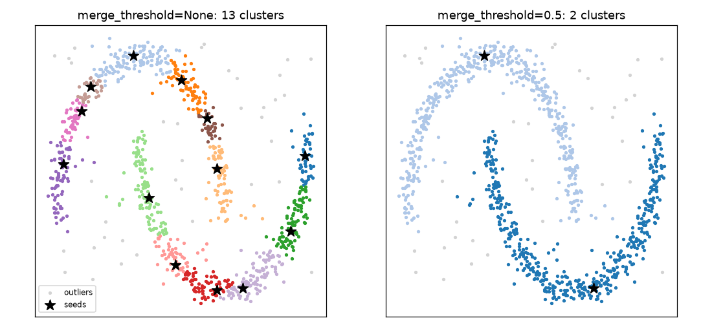

Merging Clusters
================

CLUE finds one cluster for each density peak. When a cluster is elongated or its density is not
uniform, it can have several local peaks, and CLUE splits it into several clusters, one per peak.
The optional merging step joins these clusters again, by merging the neighbouring clusters that are
separated only by a shallow density valley.

How the clusters are merged
---------------------------

For each pair of neighbouring clusters :math:`a` and :math:`b`, the merging compares two
quantities:

- the *peaks* :math:`\rho_a` and :math:`\rho_b`, the densities of the seeds of the two clusters,
  which are their highest densities;
- the *saddle* :math:`s_{ab}`, the highest density at which the two clusters touch, that is the
  maximum of :math:`\min(\rho_i, \rho_j)` over the pairs of points :math:`i` in :math:`a` and
  :math:`j` in :math:`b` closer than ``density_radius``.

The two clusters are merged when

.. math::

   s_{ab} \geq t \cdot \min(\rho_a, \rho_b)

where :math:`t` is the ``merge_threshold``, a value in :math:`(0, 1]`. A valley that is shallow
compared to the lower of the two peaks means that the two clusters are parts of the same structure.
The lower the threshold, the deeper the valleys that are merged, and the fewer the clusters.

The pairs are merged in order of decreasing saddle, and the merged cluster keeps the higher of the
two peaks, so a chain of clusters can be merged into a single one. The clusters that do not touch
within ``density_radius`` are never merged, whatever the threshold. The merging only joins
clusters: each original cluster ends up entirely in one merged cluster, and the outliers stay
outliers.

The merging is disabled by default. When it is disabled, the results are exactly the ones of the
plain CLUE algorithm.

Using the Python interface
--------------------------

The ``CLUEstering`` estimator and the ``clusterer`` class take the threshold as the
``merge_threshold`` parameter:

.. code-block:: python

    import pandas as pd
    import CLUEstering as clue

    df = pd.read_csv("data/moons.csv")
    X, weights = df[["x", "y"]].to_numpy(), df["weight"].to_numpy()

    est = clue.CLUEstering(density_radius=30., min_density=8., merge_threshold=0.5)
    labels = est.fit_predict(X, sample_weight=weights)

Without the merging, CLUE splits each moon into several clusters, one for each local peak of the
density along the moon. With ``merge_threshold=0.5`` the two moons are found again, and any
threshold between 0.1 and 0.8 gives the same result.

After the merging, ``seed_indices_`` contains one seed for each merged cluster, the one with the
highest density. The ``rho_``, ``delta_`` and ``nearest_higher_`` attributes are not changed by the
merging, so the decision graph still shows the seeds found before it.

Using the C++ interface
-----------------------

In C++ the merging is enabled with ``clue::Clusterer::setMergeThreshold``, and disabled again by
passing ``std::nullopt``:

.. code-block:: cpp

    clue::Clusterer<2> algo(density_radius, min_density);
    algo.setMergeThreshold(0.5f);
    algo.make_clusters(queue, h_points);

A threshold outside of :math:`(0, 1]` throws ``std::invalid_argument``.

Limitations
-----------

- The merging is not supported yet for batched clustering: running a batched clustering with the
  merging enabled throws ``std::logic_error`` in C++, and the ``CLUEstering`` estimator raises
  ``ValueError`` when both ``merge_threshold`` and ``sample_sizes`` are given.
- In C++, ``clue::Clusterer::getSeeds`` still returns the seeds found before the merging, including
  the ones of the clusters that were absorbed by another cluster.
