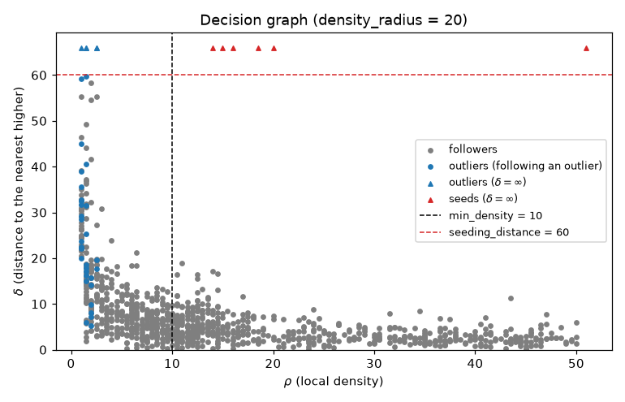

Tuning the Parameters with the Decision Graph
=============================================

CLUEstering computes two quantities for each point:

- the local density :math:`\rho`, the weighted sum of the neighbours within ``density_radius``;
- the distance :math:`\delta` from the *nearest higher*, the closest point with a higher density.

The seeds of the clusters are the points with a high density, at least ``min_density``, which are
far from any denser point, more than ``seeding_distance``. The outliers are the points with a low
density that are far from any denser point, more than ``outlier_distance``. All the other points
follow their nearest higher and end up in the same cluster.

The *decision graph* shows :math:`\delta` against :math:`\rho` for all the points, so the seeds
stand out in the top right corner, the outliers in the top left, and the thresholds can be chosen
by looking at where the points are.

Drawing the decision graph
--------------------------

After fitting the ``CLUEstering`` estimator, the densities and the distances are available in its
``rho_`` and ``delta_`` attributes, and ``plot_decision_graph`` draws them:

.. code-block:: python

    import matplotlib.pyplot as plt
    import pandas as pd
    import CLUEstering as clue

    df = pd.read_csv("data/sissa_1000.csv")
    X, weights = df[["x", "y"]].to_numpy(), df["weight"].to_numpy()

    est = clue.CLUEstering(density_radius=20., min_density=10.,
                           seeding_distance=60., outlier_distance=60.)
    est.fit(X, sample_weight=weights)
    clue.plot_decision_graph(est)
    plt.show()

The dashed lines are the thresholds: ``min_density`` is the vertical line, ``seeding_distance``
(and ``outlier_distance``, when it is different) the horizontal ones. The function returns the
matplotlib ``Axes``, and accepts ``ax`` to draw on existing axes and ``log_rho=True`` for a
logarithmic density axis.

Reading the graph
-----------------

The nearest higher is searched only within ``seeding_distance`` for the points with a density of
at least ``min_density``, and within ``outlier_distance`` for the others. The points without a
nearest higher within that distance have an infinite :math:`\delta` and are drawn as triangles on
the top edge: these are all the seeds and the outliers.

The outliers drawn as dots have a nearest higher, but following the nearest highers from them ends
in an outlier, so they are outliers too.

Choosing the parameters
-----------------------

Since :math:`\delta` is cut at the search distances, the seeds always have an infinite
:math:`\delta` and the graph does not show how far they are from each other. To choose
the parameters:

1. fit once with ``seeding_distance`` and ``outlier_distance`` larger than the expected values, so
   that :math:`\delta` is cut as little as possible. This is slower, because the search is wider;
2. choose ``min_density`` to separate the dense points from the sparse ones;
3. choose ``seeding_distance`` in the gap between the seeds on the top edge and the dense points
   below them.

In the example above all the points denser than ``min_density = 10`` have :math:`\delta < 19`, so
any ``seeding_distance`` between about 20 and 60 finds the same six clusters, while a smaller value,
such as 15, splits them into twelve.

The densities depend on ``density_radius``, so the graph is valid only for the value used in the
fit, which is shown in the title, and it has to be drawn again after changing it.

.. autofunction:: CLUEstering.plot_decision_graph
